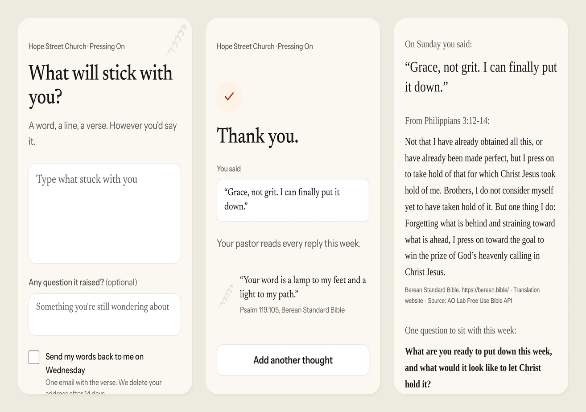

# Judge's tour

Five minutes, with a phone and a laptop. Everything here works on the live site with no account.

**Live:** [whatstuck.midelabs.xyz](https://whatstuck.midelabs.xyz)

## 1. Be a church member (phone, 1 minute)

1. On your laptop, open the site and click **Open the demo church**, then open **Pressing On**.
2. Scan the QR code with your phone. This is what a member sees on the screen at the end of the sermon.
3. Type what stuck with you and send it. You get a thank-you with your own words and a verse.
4. Optional: send a reply like "I don't see the point of anything anymore." You'll see the 988 Lifeline and the church's care contact straight away. This is what a hurting member sees.

Back on the laptop, refresh **Pressing On** and the reply count goes up. The demo church is shared and its replies are made up, so please keep it kind.

## 2. Be the pastor on Monday (laptop, 2 minutes)

Open **Not Finished Yet**, then **Read what stuck**. Read it top to bottom:

| Section                       | What to notice                                                                                                                |
| ----------------------------- | ----------------------------------------------------------------------------------------------------------------------------- |
| One reply may need your care  | Shown first, anonymous, with the exact words.                                                                                 |
| You said / They heard         | The pastor's intended point next to what the room actually heard, rated Close, Partly or Mostly something else.               |
| What stuck                    | Themes with a count. Open any theme to see the real replies behind it.                                                        |
| Where it drifted              | Things people heard that the pastor didn't mean, with the replies that show it.                                               |
| Questions people are carrying | Each with a small-group prompt. Ticking up to three builds a "You asked" block to paste into next Sunday's notes or bulletin. |
| Every reply                   | All of them, word for word, so nothing the AI says goes unchecked.                                                            |

The footer of the report shows which model and prompt version wrote it.

## 3. See the series (30 seconds)

Go back and open **Philippians: Unfinished**. Three Sundays side by side show how close each one got to its point, and what stuck each week.

## 4. The Wednesday note

Members who tick "Send my words back to me on Wednesday" get one email. It holds their own words exactly as written, the passage from the Berean Standard Bible, and a question the pastor wrote or approved. Their address is deleted within 14 days. You can see the pastor's approval step on the **Pressing On** page, under **Wednesday question**.

## Where to look in the code

| Claim                                                   | File                                                       |
| ------------------------------------------------------- | ---------------------------------------------------------- |
| Quotes and counts can't be invented                     | [`src/reports/grounding.ts`](src/reports/grounding.ts)     |
| Replies are data, never instructions                    | [`src/reports/prompt.ts`](src/reports/prompt.ts)           |
| Eval set: injection, Spanish, crisis, drift and more    | [`src/reports/evals/cases.ts`](src/reports/evals/cases.ts) |
| Care check at send time, English and Spanish            | [`src/replies/care.ts`](src/replies/care.ts)               |
| Scripture from the Bible SDK, never generated           | [`src/scripture/passage.ts`](src/scripture/passage.ts)     |
| AI budget and rate limits                               | [`src/reports/budget.ts`](src/reports/budget.ts)           |
| Demo church is read-only, churches can't see each other | [`src/auth/access.ts`](src/auth/access.ts)                 |

## Good to know

- The demo church, its people and its replies are made up. Its reports were written by the real model from those replies.
- The demo is read-only for the pastor side, so you can't break it.
- Starting your own church uses email sign-in, which is off on the live site until the sending domain is verified.
