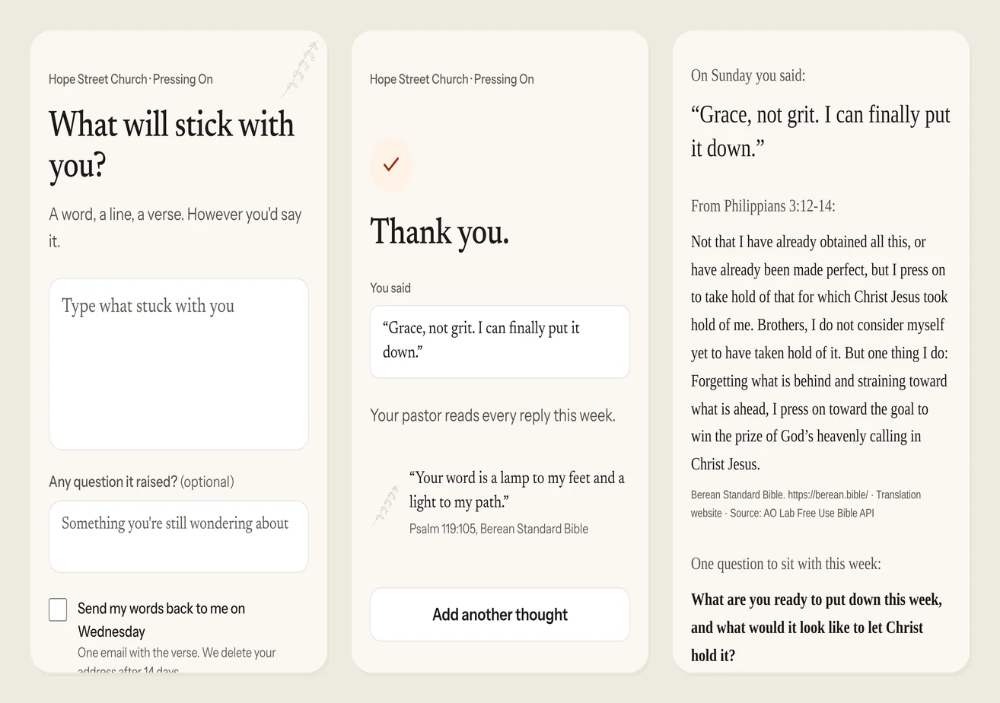
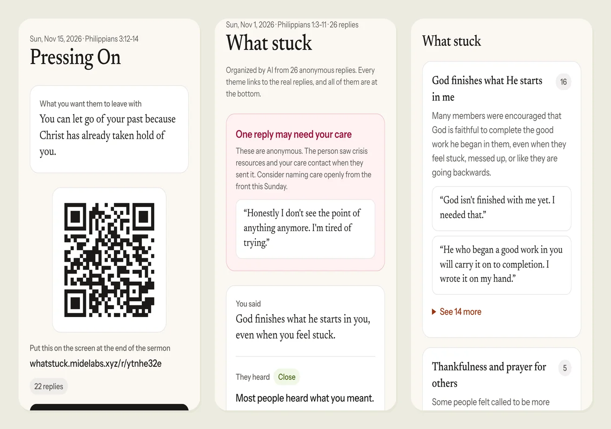
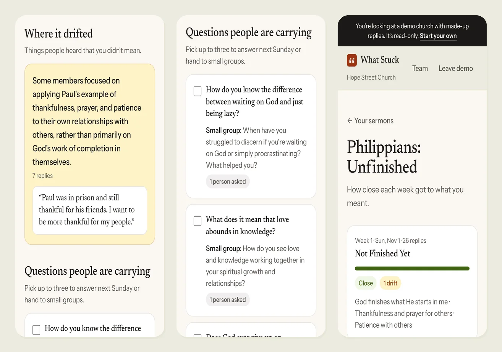

# What Stuck

Pastors preach every week and rarely find out what people took home. What Stuck asks the congregation one question after the sermon, "What will stick with you?", and on Monday shows the pastor how close the room got to the point they meant to make.

**Live:** [whatstuck.midelabs.xyz](https://whatstuck.midelabs.xyz) · **Judge's tour:** [JUDGES.md](JUDGES.md) · **Track:** Discipleship & Spiritual Growth


## Why it matters

The only sermon feedback most pastors get is "Good sermon, Pastor" at the door. Surveys ask people to rate the sermon, which is the wrong question, and they mostly reach the people who already talk to the pastor. Meanwhile the person who quietly heard something painful, or left with a real question, goes home unheard.

What Stuck gives everyone in the room ten seconds and one honest question. The pastor gets a clear picture of what landed, and members get their own words back in the middle of the week, so Sunday keeps working after Sunday.

## A week with What Stuck

| When             | Who                  | What happens                                                                                                                                     |
| ---------------- | -------------------- | ------------------------------------------------------------------------------------------------------------------------------------------------ |
| Before Sunday    | Pastor               | Writes one line, "what I want them to leave with," and gets a QR slide.                                                                          |
| After the sermon | Members              | Scan, type what stuck in their own words, and optionally ask a question. No app, no account, no name.                                            |
| Monday           | Pastor               | Reads one page: said vs. heard, themes backed by real quotes, where it drifted, the questions people are carrying, and anyone who may need care. |
| Wednesday        | Members who opted in | Get one email with their own words, the passage, and a question the pastor approved.                                                             |







## What the AI does, and what it never does

| AI does                                                                                       | AI never does                                                                                                            |
| --------------------------------------------------------------------------------------------- | ------------------------------------------------------------------------------------------------------------------------ |
| Groups replies into themes, each linked to the replies behind it                              | Grades the sermon or the preacher                                                                                        |
| Compares what people heard with what the pastor meant                                         | Writes or paraphrases Scripture. Passages come from the [faith.tools Bible SDK](https://faith.tools/app/bible-sdk) (BSB) |
| Points out where people heard something the pastor didn't mean                                | Invents quotes or numbers. References to replies that don't exist are dropped, and every count is computed in code       |
| Turns questions into small-group prompts and a "You asked" block for next Sunday              | Sends anything on its own. The pastor approves the Wednesday question first                                              |
| Flags replies that may need care, alongside a word check that runs the moment a reply is sent | Asks for names, or keeps email addresses longer than 14 days                                                             |

Members see "Anonymous. Your pastor reads every reply. AI helps sort them." before they send. Every reply is shown word for word in the report, so the pastor can always check the AI against the source.

## Care comes first

When a reply sounds like someone is hurting (in English or Spanish), the member immediately sees the 988 Lifeline and their church's care contact. On Monday it sits at the top of the report, still anonymous, so the pastor can name care openly from the front.

## Built to be trusted

- **Grounded reports.** The model returns schema-checked JSON. Member replies go in as data, never as instructions, and the model has no tools.
- **Evaluated.** A 10-sermon eval set covers small churches, mostly-Spanish replies, prompt injection, heavy drift, off-topic replies and crisis language. The current prompt passes 10 of 10.
- **Traceable.** Every report stores the model and prompt version that produced it.
- **Protected.** Rate limits on replies, sign-in and every AI run (per sermon, per church and site-wide per day) keep the service and the AI budget safe. Strict security headers, same-origin checks on every write, and hashed sign-in links.
- **Accessible.** Built phone-first, with every page checked against WCAG 2.2 AA in automated browser tests.
- **Tested.** 153 unit and database tests, 11 browser tests on phone and desktop, and CI on every push (types, lint, build, dependency audit, secret scan).

## Run it locally

Requires Node 22 and Postgres 16.

```bash
cp .env.example .env.local
```

```bash
npm install && npm run db:migrate && npm run db:seed && npm run dev
```

Reports need `GEMINI_API_KEY` (or `ANTHROPIC_API_KEY`). Without `RESEND_API_KEY`, emails print to the terminal in development.

```bash
npm run check
```

```bash
npm run test:e2e
```

```bash
npm run eval:reports
```

The `Dockerfile` builds the production image. On startup it applies migrations and creates the demo church. Three scheduled calls, sent with `Authorization: Bearer $CRON_SECRET`, run the jobs: `POST /api/cron/notes` (every 15 minutes), `POST /api/cron/reports` (Monday 7 AM) and `POST /api/cron/cleanup` (daily).

## Known limits

- It reads text only. It doesn't listen to the sermon itself.
- Care detection is a safety net. It can miss things and sometimes flags too much, which is why it only ever shows resources and never acts on its own.
- On the live site, email sign-in for new churches is off until the email domain is verified, so the demo church is the way to explore.

Built during the AI for Church Hackathon 2026 (Oct 30 to Nov 27). MIT licensed.
