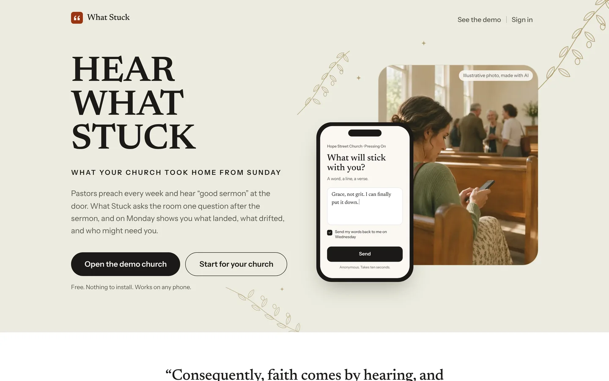
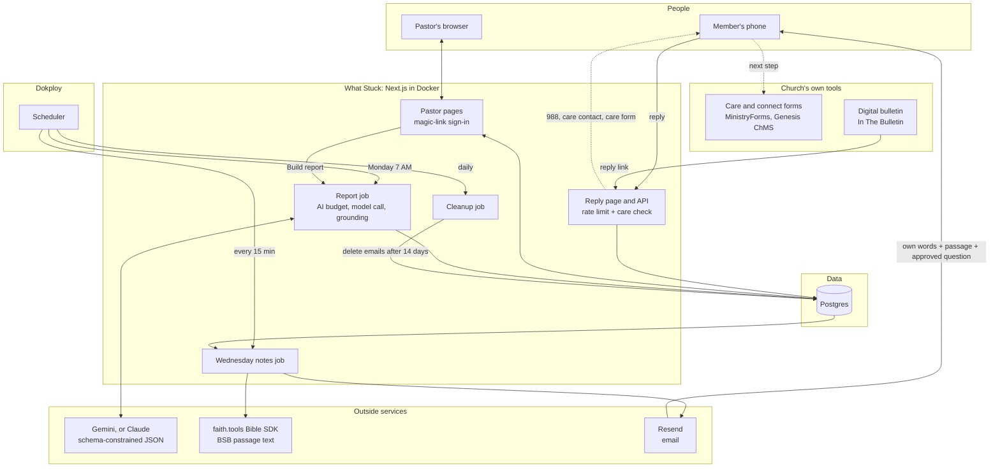

# What Stuck

Pastors preach every week and rarely find out what people took home. What Stuck asks the congregation one question after the sermon, "What will stick with you?", and on Monday shows the pastor how close the room got to the point they meant to make.

**Live:** [whatstuck.midelabs.xyz](https://whatstuck.midelabs.xyz) · **Judge's tour:** [JUDGES.md](JUDGES.md) · **Track:** Discipleship & Spiritual Growth · **License:** MIT



## Contents

- [About](#about)
- [A week with What Stuck](#a-week-with-what-stuck)
- [Features](#features)
- [How the AI works](#how-the-ai-works)
- [Faithfulness and responsible AI](#faithfulness-and-responsible-ai)
- [Care and safety](#care-and-safety)
- [Privacy](#privacy)
- [Integrations and partners](#integrations-and-partners)
- [How we built it](#how-we-built-it)
- [Quality, accessibility and performance](#quality-accessibility-and-performance)
- [Architecture](#architecture)
- [Run it locally](#run-it-locally)
- [Known limits and what's next](#known-limits-and-whats-next)

## About

### The problem

The only sermon feedback most pastors get is "Good sermon, Pastor" at the door. Surveys ask people to rate the sermon, which is the wrong question, and they mostly reach the people who already talk to the pastor. Meanwhile the person who quietly heard something painful, or left with a real question, goes home unheard, and the pastor plans next Sunday without knowing what landed.

### What it does

It gives everyone in the room ten seconds and one honest question, with no app, no account and no name. The pastor gets a one-page Monday report: what the room heard compared with what they meant, themes backed by people's exact words, where the message drifted, the questions people are carrying, and anyone who may need care. Members who want it get their own words back on Wednesday with the passage and one question from their pastor, so Sunday keeps working in the middle of the week.

### Who it's for

- **Pastors and teaching teams** at small and mid-size churches without a research budget or a staff member to run surveys.
- **Care teams and deacons**, who see which anonymous replies may need care and can point people to the church's own care form.
- **Small-group leaders**, who get discussion questions drawn from what people actually asked.
- **Members**, who are heard without having to find the pastor after the service.

All a church needs is a screen or a printed QR code, and people with phones.

## A week with What Stuck

| When             | Who                   | What happens                                                                                                                                    |
| ---------------- | --------------------- | ----------------------------------------------------------------------------------------------------------------------------------------------- |
| Before Sunday    | Pastor                | Writes one line, "what I want them to leave with," and downloads a QR slide.                                                                    |
| After the sermon | Members               | Scan, type what stuck in their own words, and optionally ask a question. No app, no account, no name.                                           |
| During the week  | Members who missed it | Reply from the link in the church's digital bulletin.                                                                                           |
| Monday           | Pastor and team       | Read one page: said vs. heard, themes backed by real quotes, where it drifted, the questions people are carrying, and anyone who may need care. |
| Wednesday        | Members who opted in  | Get one email with their own words, the passage, and a question the pastor approved.                                                            |
| Next Sunday      | Pastor                | Answers the top questions from the front with a ready-made "You asked" block.                                                                   |


## Features

### For members

- **One-screen reply page** that opens from a QR code or link. Large type, works on any phone, no sign-up.
- **Their own words back.** The thank-you screen shows exactly what they wrote, with a verse from the Berean Standard Bible.
- **Optional Wednesday note** with their words, the sermon passage and the pastor's question. The address is deleted within 14 days.
- **A next step.** If the church has a connect card (In The Bulletin, MinistryForms, Genesis ChMS or any form), the thank-you screen offers it.
- **Immediate help when it's needed.** A reply that sounds like someone is hurting shows the 988 Lifeline, the church's care contact, and a button to the church's own prayer or care form.

### For the pastor

- **Sermon setup in under a minute:** title, date, passage, and the one thing they want people to leave with.
- **QR slide and link,** plus a bulletin kit with button text, link and a ready-to-paste announcement.
- **Live reply count** on the sermon page that climbs during the service.
- **The Monday report:** said vs. heard (Close, Partly, or Mostly something else), themes with counts and quotes, drift, questions with small-group prompts, care flags, and every reply word for word.
- **"You asked" builder:** tick up to three questions and copy a block for next Sunday's bulletin, plus small-group questions.
- **Wednesday question** drafted by AI from the pastor's intended point, then edited and approved by the pastor. Nothing sends without that approval.
- **Series view** that shows how close each Sunday in a series got to its point.

### For the church team

- **Team access** for deacons, elders and the care team. The pastor who set up the church manages who's in.
- **Church settings** for the care contact, the care form link and the connect card link.
- **Monday email** when the report is ready.

## How the AI works

### What the AI does, and what it never does

| AI does                                                                                       | AI never does                                                                                                            |
| --------------------------------------------------------------------------------------------- | ------------------------------------------------------------------------------------------------------------------------ |
| Groups replies into themes, each linked to the replies behind it                              | Grades the sermon or the preacher                                                                                        |
| Compares what people heard with what the pastor meant                                         | Writes or paraphrases Scripture. Passages come from the [faith.tools Bible SDK](https://faith.tools/app/bible-sdk) (BSB) |
| Points out where people heard something the pastor didn't mean                                | Invents quotes or numbers. References to replies that don't exist are dropped, and every count is computed in code       |
| Turns questions into small-group prompts and a "You asked" block for next Sunday              | Sends anything on its own. The pastor approves the Wednesday question first                                              |
| Drafts the Wednesday reflection question for the pastor to edit                               | Speaks to members. Members only see their own words, Scripture, and what the pastor approved                             |
| Flags replies that may need care, alongside a word check that runs the moment a reply is sent | Asks for names, or keeps email addresses longer than 14 days                                                             |

### How a report is made

1. Replies get short stand-in IDs and go to the model as quoted data, next to the pastor's intended point. The prompt says anything inside a reply is data, never an instruction, and the text is escaped so a reply can't break out of its block.
2. The model returns JSON in a fixed shape, enforced by a schema: how close the room got, themes, drift, questions with small-group prompts, and care flags. Each item cites the reply IDs behind it.
3. The server maps the IDs back to real replies. Anything citing a reply that doesn't exist is dropped, items left with no real replies are removed, and every count comes from the real replies, never from the model's prose.
4. Care flags from the check at send time are always kept, even if the model misses them.
5. The report is saved with the model name and prompt version, and the pastor can read every reply under it.

In the demo church, "Not Finished Yet" turned 26 replies into 3 themes, 1 drift, 4 questions for next Sunday and 1 reply flagged for care.

### Models, cost and limits

- **Gemini** writes the reports, with schema-constrained JSON output. If one model's daily quota runs out, it moves to the next model in a configured list. Claude is supported as an alternative provider.
- **Budgets protect the service:** a cooldown per sermon, 12 reports and 20 question drafts per church per day, and a site-wide daily cap.
- **Evaluated before shipping.** A 10-sermon eval set runs the real model and checks grounding, counts, drift, questions and care. The current prompt passes 10 of 10.

| Eval case            | What it checks                                        |
| -------------------- | ----------------------------------------------------- |
| Three demo sermons   | Normal Sundays with 22 to 26 replies                  |
| Tiny church          | Four replies, so no themes are invented               |
| Mostly Spanish       | Replies in another language are understood and quoted |
| Injection heavy      | Replies that try to give the model instructions       |
| Almost all off-topic | Noise doesn't become themes                           |
| Heavy drift          | The room heard something else, and the report says so |
| Questions heavy      | Questions are grouped with honest counts              |
| Fully aligned, large | A big room that heard the point                       |

## Faithfulness and responsible AI

faith.tools publishes [six guardrails for AI apps for Christians](https://faith.tools/posts/unofficial-rules-for-ai-apps-for-christians). What Stuck is built to meet all six:

| Guardrail                                      | How What Stuck meets it                                                                                                 |
| ---------------------------------------------- | ----------------------------------------------------------------------------------------------------------------------- |
| Biblically accurate output                     | The AI doesn't teach. It organizes what members said, and the pastor reads and approves anything that goes out.         |
| Never fabricate or misrepresent Scripture      | Scripture is never generated. Every passage comes from the faith.tools Bible SDK, quoted exactly, with BSB cited.       |
| Clearly identify as AI                         | Members see "AI helps sort them" before they send. The report says it was organized by AI and names the model.          |
| Don't replace human relationships or practices | The product points toward people: the pastor, the care team, small groups, and the church's own care and connect forms. |
| Balance grace and truth                        | Drift is shown honestly next to what landed. The report never grades the preacher.                                      |
| Don't invent personal facts                    | Every quote is a real reply, linked by ID and checked in code. Counts come from the data, not the model.                |

Scripture citation follows the faith.tools [selection criteria](https://faith.tools/posts/selection-criteria): every verse shows its reference and "Berean Standard Bible (BSB)", and the full BSB notice appears on the site and in the Wednesday email.

## Care and safety

- A word check runs the moment a reply is sent, in English and Spanish. It's deliberately broad: a false alarm only shows a kind message with resources, while a miss could leave someone without help.
- The member sees the 988 Lifeline, the church's care contact, and an "Ask someone to reach out" button that opens the church's own care form. Their sermon reply stays anonymous, and they decide what to share on the church's form.
- On Monday the reply sits at the top of the report, so the pastor can name care openly from the front.
- The AI adds a second, context-aware pass. Care flags from the send-time check are always kept.

## Privacy

- **No names and no accounts for members.** Replies are anonymous.
- **Email only if the member asks** for the Wednesday note, and it's deleted within 14 days. Every note has a "Delete my email now" link.
- **Network addresses are hashed** with a secret salt for rate limiting and never stored in plain form.
- **Sign-in links and session cookies are stored only as hashes,** and used or expired ones are cleaned up daily.
- **Churches can't see each other's data.** Every read checks the viewer's church, and the demo church is read-only.
- **The AI only sees** the sermon title, passage, the pastor's intended point and the reply text.

## Integrations and partners

What Stuck works with the tools churches already use. It connects through links, embeds and copy-ready text rather than syncing member data, which keeps sermon replies anonymous.

### faith.tools

- **Bible SDK.** Every passage in the Wednesday note comes from the [faith.tools Bible SDK](https://faith.tools/app/bible-sdk) (`@faith-tools/bible-sdk`), using the Berean Standard Bible. References like "john 3: 16" are parsed and tidied to "John 3:16", looked up, cached, and sent with the translation's attribution. If a lookup fails, the note still goes out without the passage rather than with made-up text. See [`src/scripture/passage.ts`](src/scripture/passage.ts).
- **Guardrails and criteria.** The six AI guardrails and the app selection criteria shaped the design. The table above shows how each guardrail is met.

### In The Bulletin

- **Bulletin kit.** Each open sermon has a card with button text, the reply link and a ready-to-paste announcement, so a church can add a "What stuck with you on Sunday?" button to its In The Bulletin page and catch people who missed the screen. See [`bulletin-kit.tsx`](src/app/app/sermons/[id]/bulletin-kit.tsx).
- **"You asked" for the bulletin.** The Monday report builds a block from up to three real questions, ready to paste into next week's announcements.
- **Connect card.** An In The Bulletin connect card link can be set as the church's next step, shown on the member thank-you screen.

### MinistryForms

- **Care form.** A church's MinistryForms prayer request form can be set as its care form. A member whose reply sounds like they're hurting gets an "Ask someone to reach out" button that opens it, and the care team follows up in MinistryForms.
- **Connect card.** A MinistryForms connect card can be the next step on the thank-you screen.

### Genesis ChMS

- **Care and connect forms.** A Genesis ChMS form can be used for either link, so care requests and new connections land in the church's people and follow-up system.
- **Team flow.** The deacons and care team who follow up in Genesis can be added to What Stuck to read the Monday report.

All three form links are set in **Church settings** ([`src/churches/settings.ts`](src/churches/settings.ts)). Only the pastor who set up the church can change them, and only `https` links are accepted.

### Other services

| Service          | Used for                                                    |
| ---------------- | ----------------------------------------------------------- |
| Google Gemini    | Monday reports and Wednesday question drafts                |
| Anthropic Claude | Supported alternative report provider                       |
| Resend           | Sign-in links, report-ready emails and Wednesday notes      |
| PostgreSQL       | All data                                                    |
| Dokploy          | Hosting, deploys on every push, and the scheduled jobs      |
| Higgsfield       | Illustrative photos on the landing page, labeled as AI-made |

## How we built it

What Stuck was built from scratch during the hackathon window, with AI used at every stage.

- **Research and planning.** We studied the judging criteria, the partners, and what pastors say about sermon feedback, then wrote a product requirements document and a task-by-task build plan before writing code.
- **AI pair engineering.** [Claude Code](https://claude.com/claude-code) worked as the engineering partner throughout: shaping the plan, writing the backend and frontend, writing tests, reviewing each change before it shipped, and running browser and accessibility audits against the live site.
- **AI in the product.** Gemini organizes replies and drafts the Wednesday question, under the grounding, budgets and human approval described above. A 10-case eval set checks the prompt against the real model.
- **AI for visuals.** The landing page photos were generated with Higgsfield and are labeled "Illustrative photo, made with AI." Early screen layouts were explored in Figma.
- **Order of work.** Backend first (data, sign-in, replies, the report pipeline, emails, jobs), then the screens, then a design and accessibility pass, then a full audit as a judge, a member, a pastor and a deacon.
- **Every change gated.** Before any push: type check, lint, unit and database tests, a production build, and the browser tests with accessibility checks.

## Quality, accessibility and performance

- **Tests:** 163 unit and database tests, and 14 browser tests on phone and desktop covering the member reply, the care path, the live reply count, the demo, the report, settings and the bulletin kit.
- **Accessibility:** every page in the browser tests is checked against WCAG 2.2 AA with axe. Phone-first layout, tap targets of at least 44px, and readable contrast on every surface.
- **Performance:** on a throttled phone (slow 4G, 4x slower CPU), the landing page's main content draws in about 1.1 seconds and the reply page in about 0.7 seconds, with no layout shift.
- **Continuous integration:** every push runs type checks, lint, tests, a production build, browser tests, a dependency audit and a secret scan.
- **Security:** strict Content Security Policy and security headers, same-origin checks on every write, rate limits on replies, sign-in and AI runs, and a honeypot against bots.

## Architecture



| Layer     | Choice                                                                        |
| --------- | ----------------------------------------------------------------------------- |
| App       | Next.js 16 (App Router) and TypeScript, server components with client islands |
| Styling   | Tailwind CSS with a small design system (Newsreader and Instrument Sans)      |
| Data      | PostgreSQL 16 with Drizzle ORM and versioned migrations                       |
| AI        | Gemini REST API with JSON schema output, Zod validation, Claude as an option  |
| Scripture | faith.tools Bible SDK (BSB) and `grab-bcv` for reference parsing              |
| Email     | Resend                                                                        |
| Tests     | Vitest, Playwright and axe-core                                               |
| Hosting   | Docker on Dokploy, with scheduled jobs calling protected endpoints            |

### Project layout

| Folder                           | What's inside                                           |
| -------------------------------- | ------------------------------------------------------- |
| [`src/app`](src/app)             | Pages and API routes                                    |
| [`src/reports`](src/reports)     | Prompt, model providers, grounding, budget and evals    |
| [`src/replies`](src/replies)     | Reply handling and the care check                       |
| [`src/scripture`](src/scripture) | Bible SDK lookups, reference tidying and the BSB notice |
| [`src/churches`](src/churches)   | Church settings and form links                          |
| [`src/followups`](src/followups) | Wednesday notes and email retention                     |
| [`src/auth`](src/auth)           | Magic-link sign-in, sessions and access rules           |
| [`src/jobs`](src/jobs)           | Monday reports and daily cleanup                        |
| [`src/demo`](src/demo)           | The demo church and its made-up replies                 |
| [`e2e`](e2e)                     | Browser tests with accessibility checks                 |

## Run it locally

Requires Node 22 and Postgres 16.

```bash
cp .env.example .env.local
```

```bash
npm install && npm run db:migrate && npm run db:seed && npm run dev
```

| Variable                               | Needed for                                                             |
| -------------------------------------- | ---------------------------------------------------------------------- |
| `APP_URL`, `DATABASE_URL`              | Running the app                                                        |
| `AUTH_SECRET`, `IP_HASH_SALT`          | Sessions and hashed rate limits                                        |
| `CRON_SECRET`                          | Protecting the scheduled job endpoints                                 |
| `GEMINI_API_KEY`, `GEMINI_MODEL`       | Reports and question drafts (a comma-separated model list)             |
| `ANTHROPIC_API_KEY`, `ANTHROPIC_MODEL` | Claude instead of Gemini                                               |
| `AI_DAILY_LIMIT`                       | Site-wide daily cap on AI runs                                         |
| `RESEND_API_KEY`, `EMAIL_FROM`         | Sending email. Without it, emails print to the terminal in development |

```bash
npm run check
```

```bash
npm run test:e2e
```

```bash
npm run eval:reports
```

The `Dockerfile` builds the production image. On startup it applies migrations and creates the demo church. Three scheduled calls, sent with `Authorization: Bearer $CRON_SECRET`, run the jobs: `POST /api/cron/notes` (every 15 minutes), `POST /api/cron/reports` (Monday 7 AM) and `POST /api/cron/cleanup` (daily).

## Known limits and what's next

- It reads text only. It doesn't listen to the sermon itself.
- Care detection is a safety net. It can miss things and sometimes flags too much, which is why it only ever shows resources and never acts on its own.
- Partner connections are links and copy-ready text today. Next: sending small-group questions to group leaders through the Genesis ChMS API, a Spanish reply page, and a series graphic on the QR slide.
- The reply page and emails are in English. The report already understands replies in other languages.

Built during the AI for Church Hackathon 2026 (Oct 30 to Nov 27). MIT licensed.
